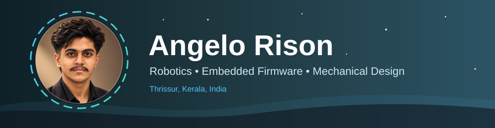

  
  
  

## 

I'm a **Robotics Engineer** from **Thrissur, Kerala** who enjoys every layer of a robot: the mechanism, the electronics, the firmware and the software that ties it together.

- 💼 Currently working as a **robotics engineer on contract**, and **open to freelance work**
- 🦾 Previously full‑time at **Astrek Innovations**, working on the firmware of an **exoskeleton for people with paralysis**: motor control, sensor and hardware integration, and system tuning
- 🔌 **Embedded:** NuttX RTOS, ESP32 and STM32, CAN · I2C · SPI · UART, and bringing **Zenoh** to microcontrollers
- 📐 **Mechanical:** robot mechanisms and custom parts in **Fusion 360** and 3D printing

## 

| | Project | What I did |
|:-:|---|---|
| 🌊 | **Underwater ROV** Smart India Hackathon 2023 · my main project | ROV for underwater inspection and maintenance *(Aug 2023 – May 2024)*. I designed and built it end to end: mechanical design, electronics and software, with a teammate's help on the ESC CAD. A ₹1.3 lakh build, funded by the team. |
| ⚡ | **Autonomous EV Charging Station** team project · design & simulation by me | A 6‑axis robot arm with cycloidal drives that plugs in an EV charger *(May – Jul 2023)*. I did all the CAD design in Fusion 360 and the simulation in Gazebo; teammates handled the report. Designed and simulated, not manufactured. |
| 🚀 | **Autonomous Mars Rover** ISRO Robotics Challenge 2024 · team project | Autonomous rover built with my team for ISRO's robotics competition *(Jan – Jun 2024)*. |
| 📡 | **[mmWave Zigbee presence sensor](https://github.com/roskuttan/xiao_24Ghz_mmwave_zigbee_Example)** | 24 GHz radar → Zigbee occupancy sensor on a Seeed XIAO, used in my Home Assistant smart home. |
| 🔗 | **[zenoh-pico-nuttx](https://github.com/roskuttan/zenoh-pico-nuttx)** · **[examples](https://github.com/roskuttan/zenoh-nuttx-examples)** | Experimental NuttX RTOS port of zenoh‑pico (serial transport, build integration) for robot‑to‑MCU messaging. |

<b>🧪 Experiments and ideas</b> (click to expand)

 

Side projects built with heavy AI assistance, or not built yet. I list them for what they are, not as finished work.

| | Project | Status |
|:-:|---|---|
| 🐉 | **[DragonSlayer](https://github.com/roskuttan/DragonSlayer)** | Open‑source replacement for MSI Dragon Center on the MSI GF63 Thin: a learning smart fan mode, real fan RPM, battery and keyboard control. One 7 MB Rust app, no background services. |
| 💰 | **[Smart Budget](https://github.com/roskuttan/smart-budget-releases)** | Android app that tracks spending from bank SMS. I use it every day. |
| 🏋️ | **tritilldie** | My personal gym app: workout plan, set logging, progress and an offline training guide. Private. |
| 🚁 | **[nano-drone](https://github.com/roskuttan/nano-drone)** | Design study of a 36 mm brushless micro quad. Not built or tested. |
| 💡 | **[open_vettam_15CCT](https://github.com/roskuttan/open_vettam_15CCT)** | Planned open‑source tunable‑white ceiling light (ESP32‑C6). Early stage. |

## 

  

 

## 

  
  
   
  
   
  
   
  <picture>
    <source media="(prefers-color-scheme: dark)" srcset="https://raw.githubusercontent.com/roskuttan/roskuttan/output/github-snake-dark.svg" />
    <source media="(prefers-color-scheme: light)" srcset="https://raw.githubusercontent.com/roskuttan/roskuttan/output/github-snake.svg" />
    
  </picture>

## 

Need help with robotics, embedded firmware or CAD as a **freelance** project? **Contact me directly to hire me**: message me on **[LinkedIn](https://www.linkedin.com/in/angelorison/)** or find all my links on **[Linktree](https://linktr.ee/roskuttan)**. I'm also on **[Upwork](https://www.upwork.com/freelancers/~012d47d8a0a92aa23e)**.

